<!-- _class: lead -->

# Backend de Observabilidade
## OrdersLab

**Branch:** `feature/O001_observability_stack`
**Item do ROADMAP:** E6.1 (Fase 6)

---

## Objetivo

Dar aos 3 serviços (`order-api`, `payment-api`, `invoice-api`) um backend de
observabilidade **real**.

Antes (item 1.12): instrumentação OTel já existia, mas sem destino — telemetria
era gerada e descartada.

**Agora:** uma requisição real é **navegável** — dá pra ver o trace, o log
correlacionado e as métricas daquele momento, tudo numa única ferramenta
(Grafana).

---

## Decisão chave: por que não um produto único (SigNoz)?

- A 1ª versão desta feature mandava usar **SigNoz** (produto único, com
  Collector e banco próprios).
- Emenda à constitution (**v4.0.0, Princípio VI**) mudou isso: nenhum serviço
  pode depender de um produto de observabilidade específico.
- Mesmo princípio que já guiava Kafka/Postgres (Princípio IV — nada de
  serviço gerenciado proprietário de nuvem), agora aplicado à observabilidade.

**Na prática:** os 3 serviços só conhecem **um endereço** — o Collector.
Trocar Jaeger/Prometheus por outro backend é mudança **só no Collector**.

---

<!-- _class: lead -->

## Diagrama de arquitetura



---

## Por que isso foi possível

Jaeger, Prometheus e Loki **já falam OTLP nativamente**.

- Nenhum exporter dedicado de fornecedor (`prometheusremotewrite`, `loki`)
- Permitiu usar o Collector na distribuição **core** (não `-contrib`)
- A distribuição core nem contém esses exporters proprietários — a própria
  escolha de imagem já impõe neutralidade de fornecedor

---

## Componentes adicionados (1/2)

**OTel Collector** — `otel/opentelemetry-collector:0.162.0` (core)
Único ponto de entrada de telemetria dos 3 serviços. Recebe OTLP (gRPC 4317 /
HTTP 4318) e roteia 3 pipelines — traces, métricas, logs.

**Jaeger** — `jaegertracing/all-in-one:1.76.0`
Backend de **traces**. Storage em memória (laboratório, não precisa
sobreviver a restart). UI própria em `:16686`, também datasource do Grafana.

**Prometheus** — `prom/prometheus:v3.13.4`
Backend de **métricas**. Receiver OTLP nativo, sem scrape.

---

## Componentes adicionados (2/2)

**Loki** — `grafana/loki:3.7.8`
Backend de **logs**. Endpoint OTLP nativo (`/otlp`) — recomendação oficial da
Grafana, em vez do exporter `loki` dedicado (hoje deprecated).

**Grafana** — `grafana/grafana:13.2.3`
Visão unificada. Os 3 datasources **provisionados como código** — sobe já
pronto, sem configuração manual via UI.

**+ k8s:** cada componente ganhou ConfigMap + Deployment + Service em
`infra/k8s/`, mesmo padrão simples do resto do projeto — sem Helm.

---

## O que mudou nos 3 serviços

Mesmo padrão replicado de forma independente (Princípio I) em `order-api`,
`payment-api`, `invoice-api`:

- **`application.properties`** — 3 propriedades novas, apontando para o
  Collector (antes usava o default `localhost:4318`, sem destino real)
- **`logback-spring.xml`** *(novo)* — `OpenTelemetryAppender`, mantendo o
  encoder ECS já usado no console
- **`config/OtlpLoggingConfig.java`** *(novo)* — instala o appender no startup
- **`pom.xml`** — nova dependência `opentelemetry-logback-appender-1.0`
  (não vem transitiva do starter)

**Zero mudança** em `Controller`/`Service`/`Repository`/testes — contrato
HTTP e mensageria Kafka idênticos.

---

## Fluxo de uma requisição real

1. `POST /api/orders` chega no `order-api`
2. O `Tracer` gera `traceId`/`spanId`
3. `Service` grava pedido + evento de outbox na mesma transação
4. Log ("Order created") sai com `traceId` — console (ECS) **e** OTLP → Loki
5. Span HTTP exportado via OTLP → Jaeger
6. Métrica da requisição exportada via OTLP → Prometheus
7. No Grafana, o mesmo `traceId` liga trace (Jaeger) → log (Loki)

---

## Validação realizada (sem mocks, containers reais)

| O que foi validado | Resultado |
|---|---|
| Trace real navegável no Jaeger | ✅ |
| Log correlacionado por `trace_id` no Loki | ✅ |
| Métrica da requisição no Prometheus | ✅ |
| Graceful degradation (FR-008) — serviços seguem respondendo sem o backend | ✅ |
| Troca de backend transparente (SC-006) — só o Collector reinicia | ✅ |
| 170 testes existentes continuam passando | ✅ BUILD SUCCESS |

---

## 2 bugs reais encontrados na validação

**1. Propriedade errada para traces**
`management.otlp.tracing.endpoint` não existe no Spring Boot 4.1 — o starter
novo usa `management.opentelemetry.tracing.export.otlp.endpoint`. Sem a
correção: métricas e logs funcionavam, mas **nenhum trace HTTP** saía.

**2. Logging estruturado quebrado silenciosamente**
`logback-spring.xml` incluía `base.xml` (legado) em vez de `defaults.xml` +
`structured-console-appender.xml` — console voltava a texto simples, perdendo
o formato ECS JSON do item 1.12.

> Só foram descobertos porque, pela 1ª vez, havia um backend real pra checar.

---

## Decisões técnicas e trade-offs

- **Collector core, não contrib** — menor superfície, reforça "nenhum
  exporter proprietário" pela própria escolha de imagem
- **Só OTLP, nunca scrape** — caminho único app → Collector → backend para
  os 3 sinais
- **Storage efêmero** (Jaeger in-memory, Loki/Prometheus locais) — aceitável
  para laboratório, evita complexidade de storage distribuído
- **Sem Helm no k8s** — diferente do SigNoz (ClickHouse/Keeper complexos),
  aqui cada componente é um Deployment+Service simples

---

## Limitações / próximos passos

- Validação em cluster k8s local **ainda não foi feita ao vivo** (manifests
  escritos e revisados, mas não aplicados) — adiada por restrição de
  recursos na máquina de dev (8 GB RAM)
- Fora do escopo desta feature (ROADMAP Fase 6, itens futuros):
  - E6.4 — tracing distribuído completo via Kafka
  - E6.5 — alerting/SLOs
  - E6.6 — dashboards como código

---

<!-- _class: lead -->

## Como testar localmente

```bash
cd infra
docker compose up -d otel-collector jaeger prometheus loki grafana
docker compose up -d postgres-api kafka order-service payment-service invoice-service

curl -X POST http://localhost:8081/api/orders \
  -H "Content-Type: application/json" -d '{"customerId":"demo","amount":100}'
```

Grafana: **http://localhost:3001** (admin/admin) — datasources já prontos

Passo a passo completo: `specs/020-observability-stack/quickstart.md`
